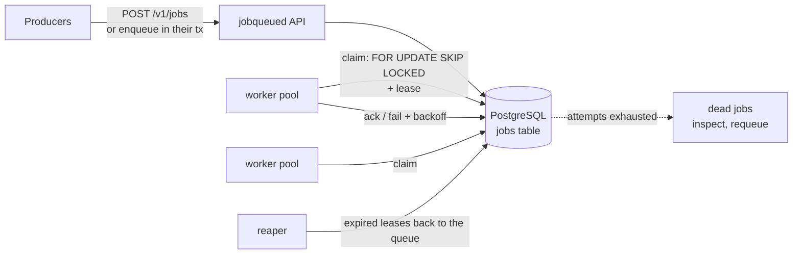
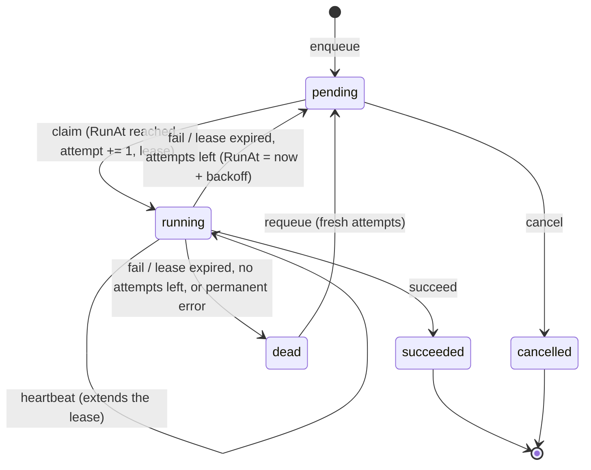

# go-jobqueue

[](https://github.com/Nguyenngoctruong274/go-jobqueue/actions/workflows/ci.yml)


[](LICENSE)

A background job queue in Go on PostgreSQL. Jobs are claimed with
`FOR UPDATE SKIP LOCKED` under a lease (visibility timeout), retried with
exponential backoff and jitter, and moved to a dead-letter queue when they
run out of attempts. A worker that crashes loses its lease, not the job.

> 🚧 Built in public as a 10-day series. See the [roadmap](#roadmap) for progress.

## Why

"Run this later" sounds simple until the process running it dies halfway.
This project answers the questions every job queue has to, with code and
tests:

- **Exactly one worker per attempt.** Many workers poll the same table;
  `SKIP LOCKED` lets them claim different jobs without blocking each other
  or claiming the same one twice.
- **At-least-once, honestly.** A job runs under a lease. If the worker
  crashes or stalls, the lease expires and the job runs again, so handlers
  must be idempotent, and the queue says so instead of promising
  exactly-once.
- **Retries that do not stampede.** Failed jobs come back after
  exponential backoff with jitter, so a downstream outage is not hit by
  every retry at the same instant. After the last attempt the job is dead,
  kept for inspection and manual requeue.
- **Enqueue with your data.** Because the queue is a table, a job can be
  enqueued in the same transaction as the business change that needs it:
  no job for a rolled-back order, no order without its job.
- **Shutdown without losing work.** Workers stop taking jobs, finish or
  release the ones they hold, then exit.

## Architecture



The diagram is the target design; the [roadmap](#roadmap) shows what is
built so far.

| Package | Responsibility |
|---|---|
| `cmd/jobqueued` | Service wiring, graceful shutdown |
| `internal/config` | Environment configuration with validation |
| `internal/job` | Job lifecycle: states, fenced transitions, retry backoff with jitter (no I/O) |
| `internal/httpapi` | Probes; job endpoints from day 7 |
| `internal/postgres` | Connection pool, embedded migrations, job store (enqueue, get, claim, succeed, fail, heartbeat, reap, cancel, requeue) |
| `internal/reaper` | Timer loop that returns silent workers' jobs to the queue |
| `internal/testdb` | Isolated PostgreSQL schema per test |

## Quick start

```bash
make up          # PostgreSQL in Docker (databases jobs and jobs_test)
make run         # jobqueued on :8080
curl localhost:8080/healthz   # {"status":"ok"}
curl localhost:8080/readyz    # {"status":"ready"}; 503 if PostgreSQL is down
make test-db     # unit tests + tests against the real PostgreSQL
```

jobqueued applies pending migrations at startup, under an advisory lock so
that several instances starting together migrate once.

Or run everything in containers: `make stack`.

## Configuration

| Variable | Default | Description |
|---|---|---|
| `JQ_DATABASE_URL` | required | `postgres://` or `postgresql://` URL of the database holding the jobs |
| `JQ_DB_MAX_CONNS` | `20` | Maximum open database connections (API, workers and reaper share them) |
| `JQ_HTTP_ADDR` | `:8080` | Listen address |
| `JQ_LOG_LEVEL` | `info` | `debug`, `info`, `warn`, `error` |
| `JQ_SHUTDOWN_TIMEOUT` | `15s` | Maximum time to finish in-flight requests |
| `JQ_SHUTDOWN_DRAIN` | `0` | Time `/readyz` reports 503 before the listener closes |
| `JQ_REAP_INTERVAL` | `5s` | How often expired leases are swept (at least `100ms`) |

Invalid configuration is reported all at once at startup, without echoing
the database URL (it holds a password).

## Probes and shutdown

- `GET /healthz`: liveness. Does **not** touch PostgreSQL, so a database
  blip does not restart every pod.
- `GET /readyz`: readiness. Returns 503 while draining or while PostgreSQL
  does not answer a ping.
- On `SIGTERM`: readiness turns 503, the service waits `JQ_SHUTDOWN_DRAIN`,
  then shuts the HTTP server down within `JQ_SHUTDOWN_TIMEOUT`.

## Job lifecycle

`internal/job` defines the rules every other part of the queue follows. It
does no I/O, so the rules are tested exhaustively on their own (every
operation from every state, plus fuzzing of arbitrary operation sequences).



- **The attempt number is a fencing token.** `Claim` returns it, and
  `Heartbeat`, `Succeed` and `Fail` must present it. If a worker stalls,
  its lease expires and another worker claims the job, the stalled worker
  comes back holding a stale token and gets `ErrLeaseLost`: it cannot
  complete or fail somebody else's attempt.
- **A lost lease is a failed attempt.** The reaper's `Expire` follows the
  same retry rule as `Fail`, so a job that crashes its worker every time
  still dies after `MaxAttempts` instead of looping forever.
- **Permanent errors skip the retries.** A handler returns
  `job.Permanent(err)` for failures that cannot succeed later (a payload
  that does not parse); the job goes straight to `dead`.
- **Stored errors are bounded.** `LastError` is valid UTF-8 without NUL
  bytes (PostgreSQL `text` rejects both) and at most 2 KiB, cut on a rune
  boundary.

### Retry backoff

After attempt *n* fails, the job waits a delay drawn from
`[ceiling × (1 − jitter), ceiling]`, where
`ceiling = min(Max, Base × 2^(n−1))`.

| Setting | Default | Effect |
|---|---|---|
| `Base` | `1s` | Ceiling after the first failure |
| `Max` | `1h` | Ceiling never grows past it |
| `JitterPercent` | `50` | Share of the ceiling randomized away; `100` is "full jitter" |

With the defaults, attempts 1 to 5 wait 0.5–1s, 1–2s, 2–4s, 4–8s and
8–16s. Half-jitter keeps jobs that failed together (say, during a
downstream outage) from retrying in lockstep, while still guaranteeing
each retry waits at least half its ceiling. The arithmetic is integer
nanoseconds and cannot overflow for any attempt count; fuzzing checks the
bounds above for arbitrary settings.

## Enqueueing

`Store.Enqueue(ctx, job.Spec)` validates the spec, inserts a pending job
and returns it with `created = true`.

| Field | Rule | Default |
|---|---|---|
| `Type` | `^[a-z0-9][a-z0-9._-]{0,127}$`, selects the handler | required |
| `Payload` | JSON, at most 1 MiB; stored as `jsonb` | `{}` |
| `Priority` | `-100` to `100`; higher runs first | `0` |
| `MaxAttempts` | `1` to `100` | `5` |
| `RunAt` | delays the job until then | now (database clock) |
| `IdempotencyKey` | up to 200 bytes of UTF-8, unique per `Type` | none |

Invalid specs fail with `job.ErrInvalidSpec`, listing every bad field. That
includes payloads `encoding/json` accepts but `jsonb` does not (`\u0000`,
lone surrogates): the store maps PostgreSQL's refusal to the same error.

**Idempotency keys.** A producer that times out does not know whether its
enqueue landed, so it retries with the same key:

- Same type and key, same payload, priority and attempt limit (`RunAt` is
  ignored, since a retry recomputes "in 5 minutes"): the existing job is
  returned with `created = false`, whatever its state.
- Same type and key but different parameters: `job.ErrIdempotencyConflict`,
  because the key was reused for different work.
- The key stays taken for as long as the row exists, so a finished job is
  never run again by a late retry.

The insert is `ON CONFLICT DO NOTHING` against a partial unique index on
`(type, idempotency_key)`. When it conflicts, a second statement reads the
row holding the key: the first statement's snapshot predates the winner's
commit and cannot see it. A test races 40 producers on one key and checks
that exactly one creates the job and all get its id back.

**Schema.** The `jobs` table restates the state machine's invariants as
`CHECK` constraints (a lease exactly while running, `attempt` within
`max_attempts`, no pending job without attempts left), so a buggy query
fails loudly instead of storing a job the domain could never produce. The
claim index `(priority DESC, run_at, id) WHERE state = 'pending'` holds
only pending jobs, so finished ones piling up do not slow claiming down.

## Claiming

`Store.Claim(ctx, ClaimRequest{Types, Limit, Lease})` starts the next
attempt of up to `Limit` due jobs (1 to 1000) and returns them in claim
order: highest priority, then earliest `run_at`, then id. `Types` limits it
to the job types a worker has handlers for. Each job comes back `running`,
its `attempt` incremented, under a lease ending at the database's `now()`
plus `Lease`. An empty queue returns an empty slice, not an error.

```sql
WITH due AS (
    SELECT id FROM jobs
    WHERE state = 'pending' AND run_at <= now()
      AND ($3::text[] IS NULL OR type = ANY($3))
    ORDER BY priority DESC, run_at, id
    LIMIT $1
    FOR UPDATE SKIP LOCKED
)
UPDATE jobs SET state = 'running', attempt = attempt + 1,
       lease_until = now() + $2 * interval '1 microsecond', updated_at = now()
WHERE id IN (SELECT id FROM due)
RETURNING ...
```

- **One worker per attempt.** A row that another transaction is claiming
  is skipped, not waited for; once that transaction commits the row is
  `running` and no longer matches. Workers never block each other and
  never get the same attempt.
- **Cheap at any table size.** The plan walks the partial index
  `jobs_claim` in claim order and stops after `Limit` lockable rows. On
  200,000 jobs (20,000 pending) a batch of 10 reads exactly 10 index
  entries and runs in 0.33 ms.
- **Same rules as the domain.** A test claims a job through SQL and
  through `job.Job.Claim` and checks the two agree, down to the lease end.
- **One clock.** Due-ness and lease ends use the database's `now()`, so
  workers with skewed clocks still agree on what is due.

Tests that back this up:

| Test | What it proves |
|---|---|
| `TestClaimEachJobOnceUnderContention` | 16 workers drain 2,000 jobs with random batch sizes: every job claimed exactly once, all at attempt 1 |
| `TestClaimWhileProducersEnqueue` | 4 producers enqueue while 8 workers claim: no job lost or handed out twice |
| `TestClaimSkipsLockedRowsInsteadOfWaiting` | With the best job locked by another transaction, Claim returns the next one at once, and the locked job is claimable after release |
| `TestClaimTakesDueJobsInOrder` | Batches follow priority, `run_at`, id; jobs whose `run_at` is in the future are not claimed |
| `TestClaimSkipsJobsThatAreNotPending` | Running, succeeded, dead and cancelled jobs are never claimed |

## Finishing, failing and reaping

A worker ends the attempt it holds with its fencing token, the `attempt`
number `Claim` returned:

```go
err := store.Succeed(ctx, j.ID, j.Attempt)
j, err = store.Fail(ctx, j.ID, j.Attempt, err)              // retry or die
err = store.Heartbeat(ctx, j.ID, j.Attempt, 30*time.Second) // for long handlers
```

Every transition runs the same way: lock the row (`SELECT … FOR UPDATE`),
read the database clock, apply the rule from `internal/job`, write the
row back, commit. The store therefore cannot drift from the domain's state
machine, and the lock makes a worker's report, a reaper's sweep and an
operator's requeue on the same job serialize instead of interleaving.

- **Stale workers are fenced.** A worker that lost its lease and reports
  late presents an old attempt number and gets `job.ErrLeaseLost`; the
  current attempt is untouched. `TestStaleAttemptIsFenced` lets worker A's
  lease expire, has the reaper hand the job to worker B, then has A
  succeed, fail and heartbeat: all three are refused and B's attempt is
  exactly as B left it.
- **Failure means backoff, then death.** `Fail` makes the job pending
  again at `now + Backoff.Delay(attempt)` (1s, 2s, 4s, … with jitter by
  default), keeps the error text (sanitized and cut at 2 KiB), and marks
  the job `dead` when the attempts are spent or the error is wrapped in
  `job.Permanent`. Retry times are checked to the microsecond against the
  database clock with a jitter-free backoff.
- **Reaping is a failure like any other.** `Store.Reap` finds running jobs
  whose `lease_until` has passed and expires each in its own transaction,
  so a long batch does not hold locks over other workers' rows. The
  attempt counts as failed with the error `lease expired before the
  attempt finished`; the job retries after the backoff, or dies. A job
  that finished or heartbeated between the scan and the lock is left
  alone. `internal/reaper` runs this on a timer in `jobqueued`, sweeps
  again at once after a full batch, and logs and retries on errors.
- **Operators.** `Cancel` stops a pending job (a running one is already
  in flight); `Requeue` gives a dead job fresh attempts, due now, keeping
  the last error visible.

`TestReapersRaceWorkers` has 40 workers finish their jobs while three
reapers sweep leases of 3 ms: whatever the interleaving, every attempt
ends exactly once, and the table agrees with what the workers were told.
Removing the row lock makes that test fail at once (reapers and workers
both ending the same attempt).

## Roadmap

- [x] **Day 1**: Scaffold: config, probes, slog, graceful shutdown, Docker, compose with PostgreSQL, CI
- [x] **Day 2**: Job domain: state machine, retry policy (exponential backoff + jitter); table tests and fuzzing
- [x] **Day 3**: Schema and migrations; enqueue with idempotency key, priority and delayed jobs
- [x] **Day 4**: Claim with `FOR UPDATE SKIP LOCKED` under a lease; concurrency tests: each job claimed once
- [x] **Day 5**: Ack, fail and retry with backoff; dead-letter queue; reaper for expired leases
- [ ] **Day 6**: Worker pool: handlers by job type, bounded concurrency, heartbeats, panic recovery, graceful drain
- [ ] **Day 7**: HTTP API: enqueue, inspect, list and requeue dead jobs, cancel
- [ ] **Day 8**: Transactional enqueue in the caller's transaction; `LISTEN/NOTIFY` wake-ups; end-to-end tests
- [ ] **Day 9**: Metrics (depth, lag, attempts, durations); benchmarks: jobs/s and p99 pickup latency
- [ ] **Day 10**: Final README, design decisions, Docker stack, v1.0.0

## License

[MIT](LICENSE)
