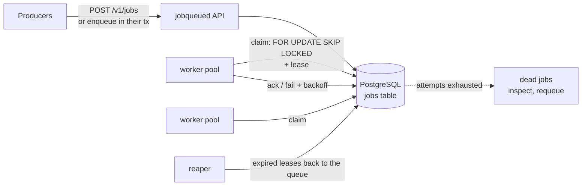

# go-jobqueue

[](https://github.com/Nguyenngoctruong274/go-jobqueue/actions/workflows/ci.yml)


[](LICENSE)

A background job queue in Go on PostgreSQL. Jobs are claimed with
`FOR UPDATE SKIP LOCKED` under a lease (visibility timeout), retried with
exponential backoff and jitter, and moved to a dead-letter queue when they
run out of attempts. A worker that crashes loses its lease, not the job.

> 🚧 Built in public as a 10-day series. See the [roadmap](#roadmap) for progress.

## Why

"Run this later" sounds simple until the process running it dies halfway.
This project answers the questions every job queue has to, with code and
tests:

- **Exactly one worker per attempt.** Many workers poll the same table;
  `SKIP LOCKED` lets them claim different jobs without blocking each other
  or claiming the same one twice.
- **At-least-once, honestly.** A job runs under a lease. If the worker
  crashes or stalls, the lease expires and the job runs again, so handlers
  must be idempotent, and the queue says so instead of promising
  exactly-once.
- **Retries that do not stampede.** Failed jobs come back after
  exponential backoff with jitter, so a downstream outage is not hit by
  every retry at the same instant. After the last attempt the job is dead,
  kept for inspection and manual requeue.
- **Enqueue with your data.** Because the queue is a table, a job can be
  enqueued in the same transaction as the business change that needs it:
  no job for a rolled-back order, no order without its job.
- **Shutdown without losing work.** Workers stop taking jobs, finish or
  release the ones they hold, then exit.

## Architecture



The diagram is the target design; the [roadmap](#roadmap) shows what is
built so far.

| Package | Responsibility |
|---|---|
| `cmd/jobqueued` | Service wiring, graceful shutdown |
| `internal/config` | Environment configuration with validation |
| `internal/httpapi` | Probes; job endpoints from day 7 |
| `internal/postgres` | Connection pool; schema and queue operations from day 3 |

## Quick start

```bash
make up          # PostgreSQL in Docker (databases jobs and jobs_test)
make run         # jobqueued on :8080
curl localhost:8080/healthz   # {"status":"ok"}
curl localhost:8080/readyz    # {"status":"ready"}; 503 if PostgreSQL is down
make test-db     # unit tests + tests against the real PostgreSQL
```

Or run everything in containers: `make stack`.

## Configuration

| Variable | Default | Description |
|---|---|---|
| `JQ_DATABASE_URL` | required | `postgres://` or `postgresql://` URL of the database holding the jobs |
| `JQ_DB_MAX_CONNS` | `20` | Maximum open database connections (API, workers and reaper share them) |
| `JQ_HTTP_ADDR` | `:8080` | Listen address |
| `JQ_LOG_LEVEL` | `info` | `debug`, `info`, `warn`, `error` |
| `JQ_SHUTDOWN_TIMEOUT` | `15s` | Maximum time to finish in-flight requests |
| `JQ_SHUTDOWN_DRAIN` | `0` | Time `/readyz` reports 503 before the listener closes |

Invalid configuration is reported all at once at startup, without echoing
the database URL (it holds a password).

## Probes and shutdown

- `GET /healthz`: liveness. Does **not** touch PostgreSQL, so a database
  blip does not restart every pod.
- `GET /readyz`: readiness. Returns 503 while draining or while PostgreSQL
  does not answer a ping.
- On `SIGTERM`: readiness turns 503, the service waits `JQ_SHUTDOWN_DRAIN`,
  then shuts the HTTP server down within `JQ_SHUTDOWN_TIMEOUT`.

## Roadmap

- [x] **Day 1**: Scaffold: config, probes, slog, graceful shutdown, Docker, compose with PostgreSQL, CI
- [ ] **Day 2**: Job domain: state machine, retry policy (exponential backoff + jitter); table tests and fuzzing
- [ ] **Day 3**: Schema and migrations; enqueue with idempotency key, priority and delayed jobs
- [ ] **Day 4**: Claim with `FOR UPDATE SKIP LOCKED` under a lease; concurrency tests: each job claimed once
- [ ] **Day 5**: Ack, fail and retry with backoff; dead-letter queue; reaper for expired leases
- [ ] **Day 6**: Worker pool: handlers by job type, bounded concurrency, heartbeats, panic recovery, graceful drain
- [ ] **Day 7**: HTTP API: enqueue, inspect, list and requeue dead jobs, cancel
- [ ] **Day 8**: Transactional enqueue in the caller's transaction; `LISTEN/NOTIFY` wake-ups; end-to-end tests
- [ ] **Day 9**: Metrics (depth, lag, attempts, durations); benchmarks: jobs/s and p99 pickup latency
- [ ] **Day 10**: Final README, design decisions, Docker stack, v1.0.0

## License

[MIT](LICENSE)
